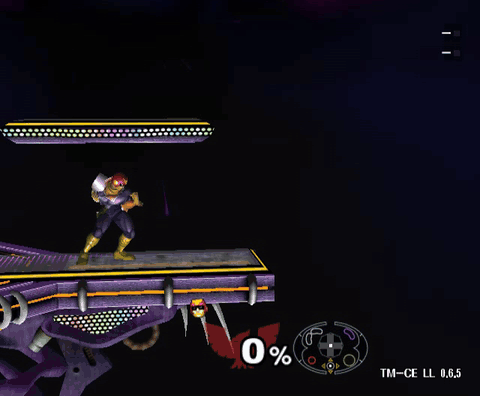
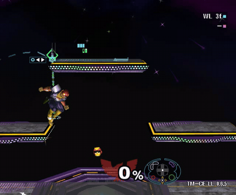
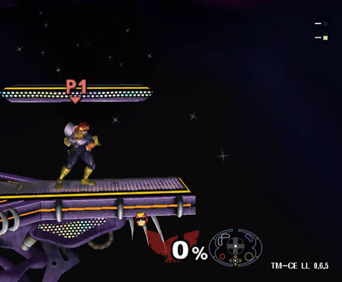
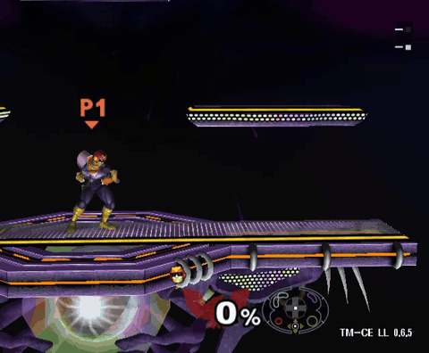
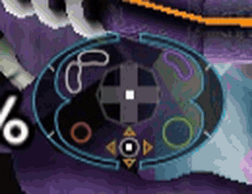
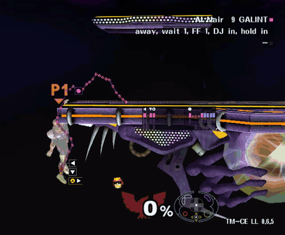
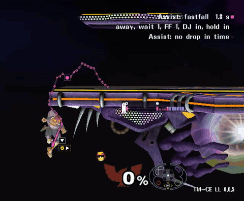

# Training Mode CE + Landing Gear

Jump at a platform, start a nair while you're still rising, and on the right frame Melee decides you've already landed. You skip the rest of your own jump and stand there, ready to act. **Landing Gear** shows you that frame before you get there, for every fighter on the roster. The game has worked this way since 2001 and has never mentioned it to anyone.

<!--  (hero, Battlefield: run off the left platform, double jump, rising nair AI onto the top platform, at defaults) -->

<i>GIF coming soon.</i>

<!--  (cast-top: Fox, Marth, Sheik, Jigglypuff, Peach, Falco, Ice Climbers, Falcon, about 1.5 s each) -->

<i>Cast reel coming soon.</i>

This is an unofficial build of [Training Mode - Community Edition](https://github.com/AlexanderHarrison/TrainingMode-CommunityEdition) (TM-CE) v1.4 with one new event. Everything else is TM-CE as it ships; its [README](https://github.com/AlexanderHarrison/TrainingMode-CommunityEdition#readme) covers the rest.

> **Not made or supported by the TM-CE team.** Landing Gear was designed and playtested by [Crackerfracks](https://github.com/Crackerfracks), and its code was written with Claude, an AI model. TM-CE doesn't take AI-written code, so this lives in a fork, and feedback goes here, not to the TM-CE Discord or repository.

## New to Melee?

Welcome. Melee is a 25-year-old party game that a community refused to put down, so now it's a sport. Turn on one thing, go play, and skip every word below you don't recognize. You'll learn them the way everyone does: by getting hit with them.

The two you'll see most. An **aerial interrupt (AI)** is starting an aerial (an attack in the air: nair, fair, bair, uair or dair) placed so that when your body's collision box updates to the attack's pose, it touches the ground, and the game lands you on the spot. It can happen rising or falling, onto a platform, the floor or a ledge; the rising ones are the ones worth having, because they end your jump early. A **NIL** (no-impact landing) is touching down with no landing lag at all.

Twelve more words, in one line each

| Word | Means |
| --- | --- |
| ECB | The invisible diamond Melee uses for your body when it checks for floors. Not where your feet are. |
| Frame | One 60th of a second, Melee's unit of everything. |
| Window | The frames a press works on. |
| Landing lag | The frames you're stuck after landing. A plain landing has a few; an aerial's has more. |
| L-cancel | Pressing L, R or Z just before landing from an aerial to halve its landing lag. |
| Fastfall | Tapping down once you've started falling, to fall faster. |
| Jumpsquat | The frames on the ground before a jump leaves it. Every fighter has its own number; Falcon's is 4. |
| Short hop, full hop | A low jump (let go of jump during jumpsquat) and a full one (hold it). |
| Waveland | An airdodge into the ground that slides you along it. The slide is the airdodge's landing lag. |
| Wavedash | A jump straight into a waveland. |
| GALINT | The ledge intangibility (frames you can't be hit) you still have once you can act on stage. |
| Frame Advance | Freezing the game and stepping one frame at a time. |

The full glossary is in [the guide](docs/guide/glossary.md).

## Install

You bring the Melee. We bring a patch file and a batch script whose name is in all caps. The patch adds one event, and that event is 24,110 lines of C, nearly half of all the C in this repository. TM-CE's entire Training Lab is 7,167 lines. Its wavedash event is 714. All 24,110 lines exist to tell you when to press A.

You need your own **Super Smash Bros. Melee NTSC 1.02** ISO. Nothing from the game is included.

1. Download `TM-CE-LandingGear-<version>.zip` from [Releases](https://github.com/Crackerfracks/TrainingMode-CommunityEdition/releases) and unzip it.
2. Make the ISO:
    - **Windows:** drag your Melee ISO onto `DRAG VANILLA MELEE HERE.bat`.
    - **Linux / macOS:** install xdelta (`sudo apt install xdelta3`, `sudo pacman -S xdelta3` or `brew install xdelta`), then run `./build_linux_and_mac.sh path/to/melee.iso`.
3. That writes `TM-CE-LandingGear.iso` next to the script. It never overwrites an official `TM-CE.iso`.
4. Open it in Dolphin (Slippi's Dolphin works). It uses TM-CE's game ID (GTME01), so Dolphin treats it like TM-CE.

The patch failed

The ISO isn't NTSC 1.02. A clean NTSC 1.02 ISO has the MD5 `0e63d4223b01d9aba596259dc155a174`. More in [Troubleshooting](docs/guide/troubleshooting.md).

## Your first minute

1. Event Mode → **Character-specific Tech** → **Landing Gear** (the last event on the page). Pick anyone; Captain Falcon is the example here. Pick Battlefield.
2. Run off the left platform and double jump toward the top one.
3. A pink strip of frame cells appears in the corner. When a solid cell reaches the white gate, press A.
4. You land on the top platform on the frame you pressed. That's an aerial interrupt.

Miss it and the strip turns slate blue, the color of quiet disappointment. Do it again. That's the whole event; everything else is about doing it in more places.

<!--  (first-minute, Yoshi's Story: short hop up to a side platform with an AI, at defaults) -->

## What it shows

Landing Gear simulates where your fighter's ECB is headed and marks what's possible on the way. It starts with only the useful parts on; the rest are a menu away.

| Effect | What you see | On at start |
| --- | --- | --- |
| [AI cues](docs/guide/cues.md) | A pink timer counting down to the frame an aerial lands you early | Yes |
| [Waveland cues](docs/guide/cues.md) | A cyan timer for a perfect waveland onto a platform or the floor, and for the wavedash out of a jump | Yes |
| [NIL cues](docs/guide/cues.md) | A green timer for a landing with no landing lag at all | No |
| [Timers](docs/guide/timers.md) | The Fixed Strip in a corner, as Cells, a Highway, a Dial or a Conveyor; or Near You, riding with your fighter | Cells |
| [Spot timers](docs/guide/cues.md#spot-cues) | Brackets closing in on the landing spot itself | Yes |
| [Wavedash timer](docs/guide/timers.md) | A WD lane in the strip, pips under your feet or a ring on the floor, counting out of the jumpsquat | Cells |
| [Paths](docs/guide/paths.md) | Where your ECB and body will go, with dots per frame, input markers and shaded bands where a press works | Markers, dots, bands and the ledge route |
| [Controller](docs/guide/hud.md) | Your real stick and buttons beside your percent, optionally with a ring closing on the button to press | Yes, cues off |
| [Jump Timing](docs/guide/jump-timing.md) | In a fall, when to double jump to set up an AI or NIL; on the ground, what a hop leads to | No |
| [Ledge routes](docs/guide/ledge.md) | From the ledge, every route back to stage that keeps GALINT | Yes |

The landing path is where your ECB will touch down: the invisible diamond Melee uses instead of feet. It has never once been where you thought it was, and it has no plans to start.

<!-- one GIF per effect at defaults, then collapsed comparisons -->
<table>
<tr>
<td width="50%" valign="top"><i>GIF coming soon</i><!--  (nil, Dream Land) --> <b>NIL</b></td>
<td width="50%" valign="top"><i>GIF coming soon</i><!--  (waveland, Pokemon Stadium) --> <b>Perfect waveland</b></td>
</tr>
<tr>
<td valign="top"><i>GIF coming soon</i><!--  (wavedash, Final Destination) --> <b>Wavedash timer</b></td>
<td valign="top"><i>GIF coming soon</i><!--  (pad-crest, Battlefield, cropped to the controller and the fighter) --> <b>Controller</b></td>
</tr>
</table>

The same jump with every timer style

<!-- docs/media/strip-cells.gif, strip-highway.gif, strip-dial.gif, strip-conveyor.gif; near-bubble.gif to near-oldstrip.gif; travel-fixed.gif, travel-catchup.gif -->
GIFs coming soon. Each style is explained in [Timers](docs/guide/timers.md).

Everything on at once

<!--  (everything-jump, Battlefield) -->
Version 0.6.5 shipped like this by default. A friend looked at the GIFs and said "busy," which was generous.

The whole cast

Every slot on the character select works: Zelda and Sheik both, Ice Climbers as Popo. One rising AI each, on Battlefield. A fighter whose clip can't show one is listed here, not faked. The few things that differ per fighter are in [Troubleshooting](docs/guide/troubleshooting.md#limits).

<!-- docs/media/cast/<fighter>.gif, 26 clips (Zelda and Sheik both), 320 px, in a table -->
GIFs coming soon.

## Presets and the quick menu

Hold L or R all the way down and press D-pad up or down: the quick menu opens over a frozen example of what your settings look like. Let go of the trigger and it stays. The D-pad picks a preset or changes a setting, the stick drops you straight back into the game, and B closes it.

| Preset | For |
| --- | --- |
| Defaults | AI and waveland cues, the Fixed Strip, landing-spot brackets, the controller. Where everyone should start. |
| Minimal | The AI cue and the Fixed Strip. Waveland cues, the landing spot, the waveland and wavedash timers, frame dots, the controller and the info panel go off. For when you mostly have it and want the screen back. |
| Everything | Every cue, path, timer and sound with a plain on switch. For screenshots and regret. |
| Ledge Drill | Ledge routes of both kinds, back to the same ledge after every try. |
| Preset 1 to 4, User Custom | Yours, saved to the memory card. |

<!--  (by pad, Battlefield: quick menu open over a frozen jump, flip a card, play out with the stick) -->

Saving your own, Auto Fade, and the memory card

Trigger + A saves over the preset you're on; trigger + X or Y saves a new one. Presets live in one file on the memory card, TMCE_LandingLab, 1 block. **Auto Fade** dims each cue as your hit rate on it climbs, so the ones you've learned get out of the way. Details in [Presets and the quick menu](docs/guide/presets.md) and [Visibility](docs/guide/visibility.md).

## Ledge practice

Hang on a ledge and Landing Gear lists every route back to stage that keeps GALINT: drop, wait, fastfall, double jump, then a NIL or an AI. Browse them with D-pad up and practice the one you can actually do.

- **Assist** freezes the game on each input of the route until you press it, then plays on at full speed. Shorten its wait as the timing sinks in.
- **Drop Drill** is for the first possible ledge drop.
- Resets and starting positions work like TM-CE's ledgedash event.
- **15 GALINT Demo** and **Practice 15 GALINT** play and drill one Falcon route on Battlefield that dashes with 15 frames of intangibility left. Captain Falcon on Battlefield only.

<table>
<tr>
<td width="50%" valign="top"><i>GIF coming soon</i><!--  (ledge-route, Battlefield) --> <b>A route into a nair AI</b></td>
<td width="50%" valign="top"><i>GIF coming soon</i><!--  (assist, Battlefield) --> <b>Assist waiting on you</b></td>
</tr>
</table>

How routes are found

The event simulates your ECB through every drop timing, fastfall, double jump frame and aerial within reach of the ledge, keeps the ones that land with GALINT, and sorts them by how much is left. It starts from where your fighter hangs, which is a different spot for each one. Four fighters have no route that keeps GALINT at all (Kirby, Jigglypuff, Peach and Pichu); that's the game's call. More in [Ledge Practice](docs/guide/ledge.md).

## Jump Timing

Falling past a platform with your double jump left, Jump Timing shows when to jump and when to press the aerial to land an AI or NIL on it. It also works from a platform drop. On the ground it shows what a short hop or full hop leads to, standing still or on the move, and it sees a run off a platform's edge coming before you leave it.

<!--  (jump-timing, Fountain of Dreams: fall into a double jump nair AI) -->

See [Jump Timing](docs/guide/jump-timing.md) for targets and limits.

## Controls

| Input | Does |
| --- | --- |
| Start | Menu |
| L or R all the way + D-pad up/down | Quick menu |
| L + R all the way + D-pad up/down | Hide or show everything Landing Gear draws |
| D-pad right (hold) | Save your position |
| D-pad left | Load it |
| D-pad down | Frame Advance on/off |
| Advance Button (Z by default, set in Speed) | One frame forward during Frame Advance; hold to step slowly |
| D-pad up, on a ledge | Next ledge route |

The D-pad does nothing while a trigger is partway in, so shielding can't freeze the game by accident. The Controls row of the main menu lists all of this in game.

## Menus

| Menu | What's in it |
| --- | --- |
| [Presets](docs/guide/presets.md) | Pick, load, save and name presets, and the one to start with |
| [Cues](docs/guide/cues.md) | Which landings get cues, AI Filter and AI Aerial, body flash, platform glow, [Intensity and Auto Fade](docs/guide/visibility.md), rumble |
| [Timers](docs/guide/timers.md) | Near You, the Fixed Strip (Cells, Highway, Dial, Conveyor), landing spot, waveland and wavedash timers, Note Travel |
| [Paths](docs/guide/paths.md) | Landing and body paths, ledge route, input markers, window bands, marker size, frame dots, slide-off, jump preview |
| [HUD](docs/guide/hud.md) | Controller position, look, size and cues, shield drop zone, info panel, quick menu |
| [Sounds](docs/guide/hud.md#sounds-menu) | The hit chime and which slips buzz |
| [Ledge Practice](docs/guide/ledge.md) | Routes, Assist, Drop Drill, starting position and resets, Keep Ledge Invincibility, the 15 GALINT demo and practice |
| [Jump Timing](docs/guide/jump-timing.md) | When it shows and where it aims |
| [Camera](docs/guide/camera.md) | Camera modes and named views per stage |
| [Speed](docs/guide/camera.md#speed-menu) | Game speed, Frame Advance and the Advance Button |
| [Developer](docs/guide/troubleshooting.md#developer-menu) | Accuracy count, collision view, debug log, test scripts, forgetting learned ECB frames |
| [Controls](docs/guide/README.md#controls), Help | Every button the event uses outside the menu, and the color legend |

## FAQ

**Is this cheating?**
Only if you can get the pink path to show up in bracket. If you can, open an issue. That's a much bigger bug than anything in here.

**Which fighters work?**
All of them. Every slot on the character select, Zelda and Sheik both, Ice Climbers as Popo. It was Captain Falcon only until 0.9.19, because Crackerfracks plays Falcon and that was the whole meeting. The other 24 took four days and a laptop.

**Do falling AIs count?**
They're real aerial interrupts. They also save about a frame, in situations so specific they'd need their own ruleset, so the default AI Filter (Useful) hides any AI that saves fewer than 4 frames, which is nearly all of them. Set it to All if you collect useless things.

**Why is it called Landing Gear?**
It was Landing Lab until October 13. LG, if you like, is also Lag Gone. The two-day gap between the name being suggested and the name being used is in the Confessions.

**Why is it on the Character-specific Tech page?**
That's where it was filed when it was Falcon only, and it's the last event on the page. The name is the game's, not a limit.

**Does it work on console?**
It's only been tested in Dolphin. If you try it on a console, tell us what happened.

**Can this go into TM-CE?**
No. TM-CE doesn't take AI-written code, which is a reasonable policy and the reason this is a fork.

**The cue said I'd land an AI and I didn't.**
Then one of us is wrong. Frame Advance will tell you which, and so far it has not always been you. Open an issue either way.

## Confessions

Things that went wrong on the way here, all true.

Read them

- The first definition of an aerial interrupt in this project was "landing in the autocancel window." That's a different thing. Correcting it took one message. The code took longer.
- Until October 12 the event was one C file, 18,370 lines long. It is now 50 files. The compiled output is byte for byte the same, so nothing was fixed; it's just easier to see what wasn't.
- The AI's test runs pressed menu buttons on a timer, blind. When the laptop lagged, the presses landed in Float Cancelling Training instead, and the character-select cursor had been dropping on Donkey Kong instead of Falcon the entire time. Reading the cursor out of game memory fixed it. Crackerfracks had to suggest that.
- One test session on the laptop idled out and killed its own capture halfway through Zelda. Another capture pressed down-B partway through and turned Zelda into Sheik, so the file held half of each.
- On October 13 the AI's own bug scan found that when Zelda turned into Sheik in play, the trainer kept using Zelda's data for Sheik. It reloads now. Nobody had noticed.
- Pichu, placed on the ledge by a test script, would not hang. He stood up on the ledge's corner and walked off. He now falls into the ledge from the spot TM-CE's own ledgedash training starts a fall, which took five commits.
- Peach's double jump keeps rising for about 50 frames. The ledge route search looks 45 frames past the jump and finds nothing. Peach is still rising.
- Version 0.6.5 turned every effect on at once: paths, dots, rings, strips, glows, ticks and a controller, all moving at the same time. A friend saw the GIFs and said "busy." The defaults have been quieter since.
- Jump Timing from the ground was scrapped in 0.8.4. Its replacement, a guide painted on the floor, knew five ground speeds. Melee has more than five. It lives behind an `#ifdef` until after 1.0, thinking about what it did.
- The AI told Crackerfracks that nothing of its was running on his laptop while he played. Something was.
- The name Landing Gear was suggested on October 11. The AI's notes dropped it, Crackerfracks assumed it had been done, and it was renamed on October 13. For two days the project was called Landing Gear by exactly one person.
- A 2-core laptop runs every test in this project. It also runs Dolphin, the capture harness and, in two of ten test boots, a window manager reload mid-route.
- The jump arc preview is one of the oldest features in Landing Gear. Crackerfracks keeps it off. He has said so in writing.
- Designed by Crackerfracks, a Falcon **main**, whose playtest notes for 0.6.5 ran 3,206 words. This README passed that today.
- These jokes were written by Fable, another Claude model, from a list of approved targets. It is on the list.

## Known limits

- The 15 GALINT demo and practice are Captain Falcon on Battlefield only.
- Kirby, Jigglypuff, Peach and Pichu get no ledge route that keeps GALINT. Kirby and Jigglypuff's routes and jump plans use their first air jump only.
- Tested in Dolphin, not on console.
- A path drawn gray needs an ECB frame the built-in data doesn't cover; the event learns it as you play.
- Full list in [Troubleshooting and limits](docs/guide/troubleshooting.md#limits).

## Feedback

Found a cue that lied, or a better ledge route? Open an issue on [this repository](https://github.com/Crackerfracks/TrainingMode-CommunityEdition/issues). Say which stage and fighter, and count the frame you pressed on in Frame Advance. Not the TM-CE Discord: they didn't write this and shouldn't have to hear about it.

## Building from source

See [DEVELOPMENT.md](DEVELOPMENT.md). `./build.sh path/to/melee.iso release` builds the ISO and the release zip. Landing Gear is `src/landinglab.c` and the modules it includes from `src/landinglab/` (see its README); the simulation is `src/landinglab_sim.h`.

## Credits

TM-CE by its contributors, maintained by Alex Harrison, built on UnclePunch's original Training Mode. Landing Gear by Crackerfracks, written with Claude.
